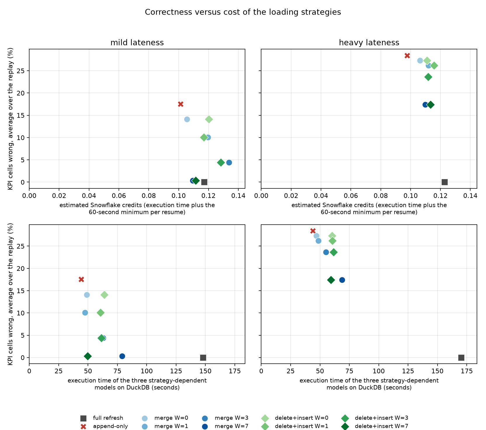
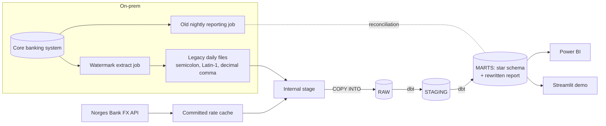

# Late Data Lab

**Live demo: [late-data-lab.azurewebsites.net](https://late-data-lab.azurewebsites.net)** (hosted on a free tier that sleeps when idle, so the first load can take a minute or so)

A synthetic retail bank on an on-prem core system, a messy legacy extract, an ELT pipeline into a Snowflake and dbt warehouse, and one controlled experiment: how wrong do warehouse KPIs get when records arrive days late or are corrected afterwards, and which incremental loading strategy puts them right, at what cost? It is a data engineering project built around a research question, and it doubles as a worked example of modernizing a legacy reporting pipeline on a cloud data platform. The whole platform also runs on DuckDB with no credentials, so everything here can be reproduced on a laptop.

## The question

Banking data is never complete on the day. A card payment from Saturday posts on Monday, a disputed charge is reversed and rebooked two weeks later, a customer moves to another county. A warehouse that loads "what is new since yesterday" has to decide what to do about rows that belong to the past. This project measures the consequences of four answers:

| Strategy | What an incremental run does |
|---|---|
| full refresh | rebuilds everything from all delivered rows |
| append-only | inserts rows booked after the newest booking date already loaded |
| merge, lookback W | reads rows booked in the last W days and upserts them by key |
| delete+insert, lookback W | reads rows booked in the last W days and replaces those whole days |

Each strategy runs through the same thirty daily extracts. After every day, three KPIs (daily account balances, monthly value by merchant category and region, daily foreign-currency totals in NOK) are compared with the truth the generator knows. Two scenarios set how late and how often corrected the data is.

## The answer

Append-only loading, the cheapest and most common incremental pattern, leaves 17.5% of the KPI cells wrong on an average day when 10% of rows arrive late (the mild scenario) and 28% when 33% do (heavy), and it never recovers: a late row is lost for good, and a missed row keeps an account's balance wrong on every later day. A merge or delete+insert that reprocesses the last W days fixes this exactly to the extent that W covers how late the data arrives. In the mild scenario a seven-day window is within 0.3% of a full refresh at a third to a half of its DuckDB cost; in the heavy scenario, where rows arrive up to a month late, the same window still leaves 17% of cells wrong. A full refresh is exact every day. On DuckDB it costs two to three times the windowed strategies at this data size, a gap that widens as history grows; on an X-Small Snowflake warehouse the ten strategies cost the same credits within a third, because at 1.4 million rows the fixed cost per statement outweighs the rows read. The lateness distribution, not the strategy, decides the window.



Details, metrics and the full tables: [docs/experiment.md](docs/experiment.md).

## Architecture



- The **core system** is a DuckDB file that the generator builds and advances one day at a time; every row carries `updated_at`.
- The **extract job** reads rows changed since its stored watermark, writes them as the legacy files the old platform expected, and only then moves the watermark. A rerun gives the same files.
- The **loader** stages the files (`PUT` and `COPY INTO` on Snowflake, a landing folder on DuckDB), keeps RAW as text, and records every file with rows loaded and rejected.
- **dbt** builds staging, intermediate and marts on both engines from the same models; the loading strategy is a variable.
- The **old nightly job** is kept as it was and reconciled against its dbt rewrite.

## Star schema

`fct_transactions` (one row per transaction), `fct_account_balance_daily` (one row per account and day), `mart_monthly_category_region` (the rewritten report), `dim_customer` (SCD type 2 from a dbt snapshot), `dim_account`, `dim_card`, `dim_merchant`, `dim_date`, `dim_currency`. Grain, keys and the SCD handling are in [docs/data-model.md](docs/data-model.md); the legacy column mapping in [docs/legacy-mapping.md](docs/legacy-mapping.md).

## How to run

### DuckDB, about five minutes

```bash
python -m venv .venv && . .venv/bin/activate      # Windows: .venv\Scripts\activate
pip install -r requirements.txt
dbt deps --project-dir transform
python -m extract.extract_fx                      # refreshes the rate cache if the network is there
python -m generator.build_core_bank --customers 500
python -m extract.extract_core --day 2024-11-30
python -m load.load_duckdb
dbt build --project-dir transform                 # seeds, snapshot, models, 129 tests
python -m legacy.run_nightly_report --run-date 2024-11-30 --full
python -m reconcile.reconcile --mode full
```

Then advance a day and load it: `python -m generator.advance_day --next`, `python -m extract.extract_core --next`, `python -m load.load_duckdb`, `dbt build --project-dir transform`. The dbt profile lives in `~/.dbt/profiles.yml`; the one used by CI is in `.github/workflows/ci.yml`. Drop `--customers` for the full-size bank (3,000 customers, about 1.4 million transactions, 150 MB of legacy files).

The experiment and the demo:

```bash
python -m experiment.run --target dev             # whole grid on DuckDB, about an hour per scenario
python -m experiment.export_demo_data
python -m streamlit run demo/app.py
```

`make help` lists the same steps as Makefile targets.

### Snowflake

1. Run `snowflake/01_account_setup.sql` to `04_row_access_policy.sql` in a worksheet (database, schemas, two X-Small warehouses with auto-suspend, resource monitors, roles, service user, stages, file formats, RAW tables, row access policies). `snowflake/make_keypair.py` creates the key pair for the service user.
2. Copy `.env.example` to `.env` and fill in the account, user and key path.
3. `python -m load.load_snowflake`, then `dbt build --project-dir transform --target snowflake`, then `python -m experiment.run --target snowflake` and `python -m experiment.collect_snowflake_costs`.

Switching engines is only `--target`. The few engine differences live in macros.

## What is tested

- **pytest** (`tests/`): the generator (determinism, integrity, lateness and correction distributions), the watermark extract including a rerun and a simulated write failure, the legacy format round trip, the FX feed and the weekend carry-forward, the loader (rejected trailers, idempotent reloads), the ground-truth KPIs against the old job, the reconciliation (nightly mode finds the late rows, full rebuild matches), and the experiment harness end to end on a small bank.
- **dbt** (`transform/`): unique, not null, relationships and accepted values on every mart, plus singular tests: balances reconcile with transactions, no balance below the account's overdraft limit, no transaction before its account opened, converted amounts within the published rate range, no duplicate business keys after staging, contiguous SCD2 history. Source freshness on RAW.
- **CI** (GitHub Actions): pytest, a small end-to-end run with `dbt build` on DuckDB, the reconciliation, and a two-cycle slice of the experiment. No credentials needed.

## Operations, cost and access control

The platform is set up as code: database, schemas, two X-Small virtual warehouses with auto-suspend after 60 seconds, resource monitors on the warehouses and on the account, roles, a key-pair service user, stages, file formats and row access policies are all SQL scripts in `snowflake/`. Loads are idempotent and audited, sources carry freshness checks, and every model and column is documented and tested, which is what keeps the pipeline stable when it runs unattended. Consumption is controlled by the monitors and the auto-suspend, and the experiment's credit estimate per query tag is checked against the metering history: [docs/cost.md](docs/cost.md). The whole Snowflake part, setup, builds and both cost grids, used about 25.4 credits of the trial. Access follows three roles (`LOADER`, `TRANSFORMER`, `REPORTER`) and row access policies that give regional roles their own region, mirrored by the Power BI row-level security: [docs/security.md](docs/security.md), [powerbi/](powerbi/). Scaling up means a larger warehouse size, nothing else changes.

## Limitations

The bank is synthetic and the lateness distributions are chosen, not measured. Thirty cycles is one month; the break-even between full refresh and windowed strategies depends on how history grows. Costs on an X-Small warehouse are dominated by fixed overhead per query. One seed per scenario. See the limitations section of [docs/experiment.md](docs/experiment.md).

## Further work

More seeds and longer replays for confidence intervals on cost; a region-at-the-time-of-transaction variant of the monthly report; streaming the extract instead of daily files; running the Snowflake grid on a Small warehouse to see how the ratios move; and a second real source next to the exchange rates.

## Repository layout

```
generator/     synthetic bank, core system, ground truth, day-by-day advance
extract/       watermark extract job, Norges Bank FX extract
legacy/        the old nightly reporting job and its runner
load/          loaders into RAW (DuckDB landing folder, Snowflake PUT and COPY INTO)
snowflake/     platform as code: warehouses, monitors, roles, stages, policies
transform/     dbt project (staging, intermediate, marts, snapshot, tests, docs)
reconcile/     old report versus rewrite
experiment/    replay, strategy runs, KPI scoring, cost collection, exports
demo/          Streamlit demo reading demo/data only
powerbi/       the report as a Power BI project (TMDL model, PBIR pages), model guide, DAX measures, row-level security, PDF and screenshots
docs/          experiment, data model, security, cost, legacy mapping, migration, ETL tool mapping, decisions
tests/         pytest suite
```

## Documentation

[Experiment](docs/experiment.md) | [Data model](docs/data-model.md) | [Legacy mapping](docs/legacy-mapping.md) | [Migration of the old report](docs/migration.md) | [Security](docs/security.md) | [Cost](docs/cost.md) | [Enterprise ETL mapping](docs/etl-tool-mapping.md) | [Decisions](docs/decisions.md)

License: MIT.
