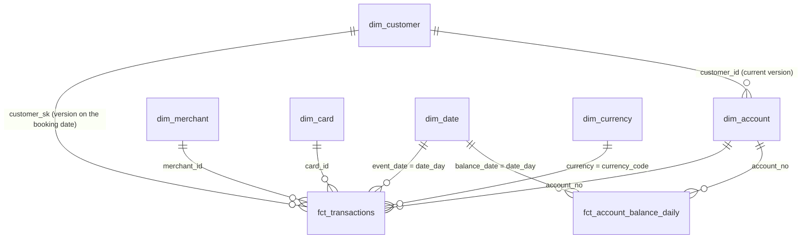

# Data model

The warehouse has three layers. `RAW` holds the files as delivered. `STAGING` types and
cleans them and keeps every delivered version. `MARTS` is a star schema plus the rewritten
monthly report. Everything from `STAGING` onwards is built by dbt and is the same on DuckDB
and Snowflake.

```
RAW (text, one row per file line)
  -> STAGING (typed views, one row per record version, duplicates removed)
     -> intermediate (current version per record, FX calendar)
        -> MARTS (dimensions, facts, monthly report)
```

## Star schema



## Grain and keys

| Table | Grain | Key | Type | Notes |
|---|---|---|---|---|
| `fct_transactions` | one row per transaction, latest delivered state | `txn_id` | transaction fact | signed amounts, NOK value at the booking date's rate, `is_corrected`, `is_reversal` |
| `fct_account_balance_daily` | one row per open account and calendar day | `account_no`, `balance_date` | periodic snapshot | end-of-day balance, net flow and transaction count of the day |
| `mart_monthly_category_region` | one row per month, merchant category and region | `report_month`, `category_code`, `region` | aggregate | the rewrite of the old nightly report, same grain and columns |
| `dim_customer` | one row per customer version | `customer_sk` (surrogate); `customer_id` + `valid_from` | SCD type 2 | `valid_from`, `valid_to`, `is_current`, `version_no` |
| `dim_account` | one row per account | `account_no` | type 1 | current state; `customer_id`, type, open and close dates, opening balance, overdraft limit |
| `dim_card` | one row per card | `card_id` | type 1 | |
| `dim_merchant` | one row per merchant | `merchant_id` | type 1 | category code, name and group from the seed |
| `dim_date` | one row per calendar day | `date_day` | calendar | year, quarter, month, month start, ISO weekday, weekend flag |
| `dim_currency` | one row per currency | `currency_code` | reference | latest published rate for display |

Natural keys are used wherever a record has a stable id in the core system. The only
surrogate key is `customer_sk`, because a customer has several versions.

## Slowly changing customers (SCD type 2)

The core system keeps only the current state of a customer. Every extract delivers the
customers that changed since the last one, with the time of the change in `updated_at`.
A dbt snapshot (`snap_customers`, timestamp strategy on `updated_at`) watches the current
version of each customer and opens a new row whenever a newer `updated_at` arrives.

`dim_customer` turns the snapshot into date ranges:

- the first recorded version starts on 1900-01-01, so history before the first extract still finds a customer row;
- each later version starts on the day of its change and ends the day the next one starts;
- the newest version has `is_current = true` and `valid_to = 9999-12-31`.

`fct_transactions` joins the version that applied on the booking date
(`event_date >= valid_from and event_date < valid_to`) and stores its `customer_sk`. Reports
that need the customer as they are today use `is_current`; reports by region at the time of
the transaction use `customer_sk`. The monthly report uses the current region on purpose, to
match the old job it replaces.

## Versions, corrections and reversals

A transaction that the core system changed after it was first written is delivered again
with a later `updated_at`. Staging keeps both versions; the fact keeps the latest one and
sets `is_corrected`. A reversal is a separate transaction with the opposite amount, the
original booking date and `reversal_of` pointing at the reversed row, usually followed by
a rebooked transaction. Sums over a period therefore net out automatically.

## Currency conversion

Amounts are stored in the transaction currency and converted to NOK at the rate of the
booking date. Norges Bank publishes rates on business days; `int_fx_rates_daily` carries
the last published rate over weekends and holidays, so every day has a rate. The converted
amount is rounded to the cent with decimal arithmetic.

## Daily balances

The balance snapshot is the opening balance of the account plus the cumulative net flow of
its transactions up to that day, for every day between the opening date and the closing
date (or the last loaded day). A late transaction changes the balance of every day from its
booking date onwards, which is why the snapshot is recomputed from the start of the
loading window on every incremental run.

Every account has an overdraft limit (`credit_limit`, zero for savings accounts and for most
students). The core system declines a debit that would take the balance below minus that
limit, so no end-of-day balance in the snapshot is lower; a singular test checks it on every
build. Incoming credits are never late or corrected in the source, so the balance the
warehouse shows for a day is never lower than the final one and the limit holds at every
load, not only after the last one.

## Tests

Generic tests cover keys (`unique`, `not_null`), references between facts and dimensions
(`relationships`) and controlled vocabularies (`accepted_values`). Singular tests check
that balances reconcile with transactions, that no transaction predates its account, that
converted amounts fall within the published rate range, that no business key is duplicated
after staging, and that customer versions tile the timeline without gaps. Source freshness
is declared on the RAW tables.
