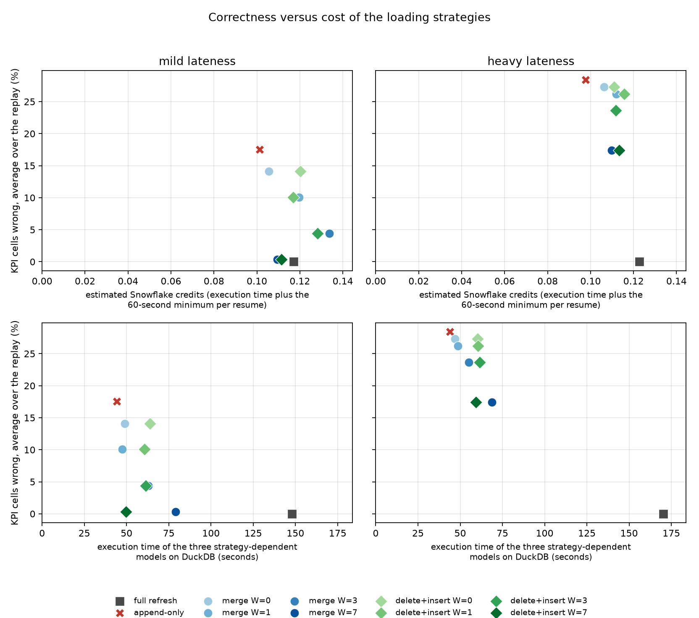
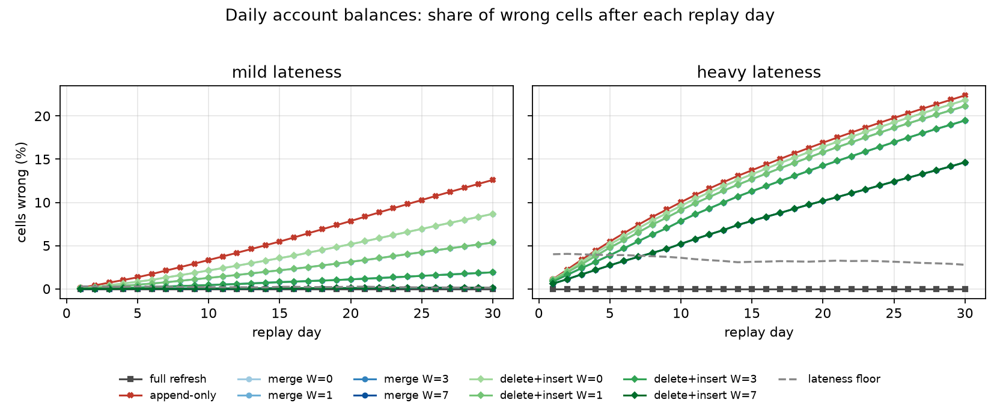

# The experiment

## Question

How much do late-arriving and corrected records distort warehouse KPIs, and which incremental
loading strategy (full refresh, append-only, merge, delete+insert) restores correctness at
what cost?

## Expectations

Written down before the runs:

1. Append-only loading drifts away from the truth roughly in proportion to the share of late and corrected records.
2. Merge or delete+insert with a lookback window W becomes correct once W covers most of the lateness distribution; cost grows with W.
3. Full refresh is always correct, but its cost grows with history size, so there is a break-even point.

## Design

**Ground truth.** The generator knows every record's true booking date, its final amount and
the day it reaches the core system. Two truths are used:

- *as of a cycle*: the latest version of every record that had reached the core system by the
  end of that day. This is what a perfect load could know, so a full refresh scores zero
  against it and every other strategy's error is caused by the strategy alone;
- *final*: every version ever, including those that arrive after the last replay day. The
  difference between the two is the **lateness floor**: the error no loading strategy can
  remove because the data has not arrived yet. It is shown as a reference line.

Both are computed directly from the generator's record versions, outside the pipeline.

**Replay.** The initial extract delivers everything the core system held on the initial
extract date. Then thirty daily cycles follow. Each day the core system receives new
records, late records for earlier days, corrections (an updated row, or a reversal plus a
rebooked row with the original booking date) and the extract job writes that day's legacy
files, with a few duplicate lines. After each day's load the whole dbt graph runs with the
strategy under test and the three KPIs are compared with the truth as of that day.

**Strategies.** One grid point is a strategy and a lookback window W in days:

| Strategy | What an incremental run does | W |
|---|---|---|
| `full_refresh` | rebuilds every model from all delivered rows | n/a |
| `append_only` | inserts rows booked after the newest booking date already loaded; never updates | n/a |
| `merge` | reads rows booked in the last W days and upserts them by transaction id | 0, 1, 3, 7 |
| `delete_insert` | reads rows booked in the last W days and replaces those whole booking dates | 0, 1, 3, 7 |

Every strategy keeps the newest delivered version of a transaction within the rows it reads.
The daily balance snapshot and the monthly report are recomputed for the same window with
delete+insert, because balances are cumulative and the report is an aggregate; a full
refresh rebuilds them. The initial build is a full build for every strategy, so all start
from the same correct state.

**KPIs.** Checked after every cycle, for dates from 75 days before the initial extract up to
the cycle day (wide enough to hold every late or corrected row):

| KPI | Cell | Value |
|---|---|---|
| daily account balance | account, day | end-of-day balance in NOK |
| monthly value by merchant category and region | month, category, region of the customer on the booking date | spend in NOK and transaction count |
| NOK totals of foreign-currency transactions | day, currency | spend in NOK |

The monthly KPI uses the region the customer had on the booking date (the SCD2 join on
`customer_sk`), and the truth uses the same information: the state delivered by the initial
extract, valid from the beginning of time, and every later version from its own date. The
monthly report mart itself keeps the old job's current-region rule for the reconciliation;
measured with that rule, a single customer moving region would rewrite the history of every
cell they ever appeared in, which is a property of the rule, not of the loading strategy
(see `docs/migration.md`).

**Error metrics.** A cell is wrong when it is missing on one side or differs by more than
half a cent (or, for the monthly KPI, when the count differs). Reported per cycle and KPI:
the share of wrong cells and the mean absolute error in NOK; summarized as the average over
the thirty cycles and the value on the last day.

**Scenarios.** Two settings of the generator, one seed each:

| | mild | heavy |
|---|---|---|
| records arriving the same day | 88% | 60% |
| arrival lag of the rest | geometric, mean 2 days, at most 14 | geometric, mean 5 days, at most 30 |
| corrected records | 1% | 4% |
| correction lag | geometric, mean 3 days, at most 45 | geometric, mean 6 days, at most 45 |

Rows the bank books itself (salary, interest, fees) and incoming transfers are never late or
corrected; only debits are. Every account has an overdraft limit, and a debit that would take
the balance below it is declined and never booked, so balances stay realistic. Both scenarios
have 3,000 customers and about 1.4 million booked transactions over two years, of which the
replay covers December 2024.

## Cost

**Snowflake.** Every dbt query carries a tag naming the scenario, the strategy, the window
and the cycle. The dbt runs use `TRANSFORM_WH`, an extra-small warehouse with auto-suspend
after 60 seconds and the result cache disabled for the service user, so that repeated queries
do real work. The daily loads into RAW run on `LOAD_WH` and are the same for every strategy,
so they stay out of the comparison. The daily balance KPI is scored on one account in ten
there (account numbers ending in 7) to keep the comparison with the truth small; the other
two KPIs are scored on every cell. Execution time per tag comes from the query history, and
credits are estimated as

    credits = execution time in hours x 1.35 credits per hour (X-Small, generation 2)

Snowflake bills at least 60 seconds every time a warehouse resumes, so resumes are counted
per run (a query that starts after the warehouse sat idle long enough to suspend) and the
estimate with the minimum is reported next to the pure execution estimate. Warehouse
metering totals, which arrive with a delay, are collected afterwards and compared with the
estimates. See `docs/cost.md`.

**DuckDB.** The whole grid runs on DuckDB first. There the cost measures are the execution
time of every dbt node and the number of staged rows each cycle had to read ("rows in
window"). They rank the strategies the same way credits do, with one difference: on a
laptop the fixed overhead per run is a larger share of the total.

## How to run it

```
python -m experiment.run --target dev                 # whole grid, both scenarios, DuckDB
python -m experiment.run --target snowflake           # same grid on Snowflake, needs credentials
python -m experiment.collect_snowflake_costs           # query history and metering into results
python -m experiment.export_demo_data                  # demo files
```

Results are Parquet files in `experiment/results/<target>/`: `kpi_errors`, `run_costs`,
`lateness_floor`, `cycles`, `summary`, the per-cycle KPI values, and the reconciliation of
the old report with the rewrite.

## Results

Both scenarios, ten grid points, thirty daily cycles each, run twice: on DuckDB on a laptop
and on Snowflake on an X-Small warehouse. "Wrong cells" is the share of KPI cells that differ
from the as-of truth, averaged over the thirty cycles; "last day" is the same share after the
thirtieth cycle. The two tables below are the DuckDB run; cost there is the execution time of
the three strategy-dependent models summed over the thirty cycles, and the number of staged
rows those cycles had to read. The Snowflake run, with credits, follows further down.



The top row of the figure is Snowflake credits, the bottom row DuckDB seconds, for the same
ten strategies.

### Mild lateness (10% of rows late, 0.8% corrected)

| Strategy | Balances | Monthly cells | FX totals | All KPIs | All, last day | Model seconds | Rows read |
|---|---|---|---|---|---|---|---|
| full refresh | 0.0% | 0.0% | 0.0% | 0.0% | 0.0% | 148 | 41.8 M |
| append-only | 6.0% | 30.7% | 15.9% | 17.5% | 24.7% | 44 | 55.1 k |
| merge, W=0 | 4.0% | 25.8% | 12.6% | 14.1% | 20.8% | 49 | 55.1 k |
| merge, W=1 | 2.4% | 20.6% | 7.2% | 10.1% | 15.4% | 48 | 113.5 k |
| merge, W=3 | 0.9% | 9.6% | 2.8% | 4.4% | 7.5% | 63 | 234.3 k |
| merge, W=7 | 0.1% | 0.9% | 0.0% | 0.3% | 0.8% | 79 | 480.9 k |
| delete+insert, W=0 | 4.0% | 25.8% | 12.6% | 14.1% | 20.8% | 64 | 55.1 k |
| delete+insert, W=1 | 2.4% | 20.6% | 7.2% | 10.1% | 15.4% | 61 | 113.5 k |
| delete+insert, W=3 | 0.9% | 9.6% | 2.8% | 4.4% | 7.5% | 61 | 234.3 k |
| delete+insert, W=7 | 0.1% | 0.9% | 0.0% | 0.3% | 0.8% | 50 | 480.9 k |

Lateness floor (as-of truth against final truth): balances 0.2%, monthly cells 11.8%, FX
totals 2.9% of cells on an average day.

Mean absolute error on an average day: append-only 221 NOK per balance, 4,734 NOK per
monthly cell, 329 NOK per FX day; merge with W=7: 1 NOK, 18 NOK and 0.

### Heavy lateness (33% of rows late, 3.2% corrected)

| Strategy | Balances | Monthly cells | FX totals | All KPIs | All, last day | Model seconds | Rows read |
|---|---|---|---|---|---|---|---|
| full refresh | 0.0% | 0.0% | 0.0% | 0.0% | 0.0% | 170 | 42.2 M |
| append-only | 13.3% | 43.5% | 28.5% | 28.4% | 36.5% | 44 | 40.3 k |
| merge, W=0 | 12.8% | 42.0% | 27.0% | 27.3% | 35.8% | 47 | 40.3 k |
| merge, W=1 | 12.3% | 40.6% | 25.7% | 26.2% | 35.1% | 49 | 84.9 k |
| merge, W=3 | 11.0% | 37.2% | 22.7% | 23.6% | 33.1% | 55 | 183.5 k |
| merge, W=7 | 7.9% | 29.6% | 14.7% | 17.4% | 26.7% | 69 | 405.7 k |
| delete+insert, W=0 | 12.8% | 42.0% | 27.0% | 27.3% | 35.8% | 60 | 40.3 k |
| delete+insert, W=1 | 12.3% | 40.6% | 25.7% | 26.2% | 35.1% | 61 | 84.9 k |
| delete+insert, W=3 | 11.0% | 37.2% | 22.7% | 23.6% | 33.1% | 62 | 183.5 k |
| delete+insert, W=7 | 7.9% | 29.6% | 14.7% | 17.4% | 26.7% | 59 | 405.7 k |

Lateness floor: balances 3.4%, monthly cells 30.1%, FX totals 12.9%.

Mean absolute error on an average day: append-only 796 NOK per balance, 15,004 NOK per
monthly cell, 871 NOK per FX day; merge with W=7: 152 NOK, 1,992 NOK and 169 NOK.



### What the data says about the expectations

**1. Append-only drifts in proportion to the late and corrected share.** Yes, roughly.
Three times the late share (10% to 33%) gives about twice the balance error (6.0% to 13.3%
of cells), 1.8 times the FX error and 1.4 times the monthly error. The proportion is not one
to one because a cell is wrong as soon as one of its rows is missing: cells with many rows
saturate. The error never recovers: a row that arrived late is lost for good, and a missed
row keeps an account's balance wrong on every later day, which is why the balance error
climbs steadily over the replay (6.0% on average, 12.6% on the last day in the mild
scenario).

**2. A window of W days makes merge and delete+insert correct once W covers the lateness
distribution, at a cost that grows with W.** Yes for the first half, with a qualification
for the second. In the mild scenario, where 88% of rows arrive the same day and the rest
within two weeks, W=7 is almost exact: 0.3% of cells on an average day, 0.8% on the last
day, against 17.5% for append-only. In the heavy scenario, where rows arrive up to 30 days
late and corrections up to 45 days after that, W=7 still leaves 17% of cells wrong; the
window has to reach the tail of the distribution, and a seven-day window does not. W=0
(reprocess only the newest day) is barely better than append-only: it repairs same-day
corrections and duplicates, not lateness. Cost does grow with W, but on DuckDB much more
slowly than the work: rows read grow nine times from W=0 to W=7 while the model time grows
by a fifth to a half, because the fixed work per run (scanning the staged rows, recomputing
the balance window for every account) dominates at this data size. Merge and delete+insert
are indistinguishable in correctness, since they read the same rows; their cost differs
within the noise of the measurement, which is considerable on a laptop running both
scenarios at once.

**3. Full refresh is always correct and its cost grows with history.** Correct every day in
both scenarios, by construction and in fact. On DuckDB it cost two to three times the model
time of merge or delete+insert with W=7, almost all of it in the daily balance snapshot (77
to 83 s against 14 to 16 s) and the transaction fact. On the X-Small Snowflake warehouse it
cost the same credits as the windowed strategies, for the reason given in the Snowflake
section below. A month of replay is too short to see the break-even move, but its direction
is clear: the full refresh cost grows with every day of history and the windowed cost does
not.

**What was not expected.** The first version of the monthly KPI used the customer's current
region, as the old nightly report does. Measured that way, the handful of customers who
moved during the replay dominated the error of every incremental strategy, because a move
rewrites that customer's history in every cell they ever appeared in, and only a full
refresh follows. That is a property of reporting history by a type 1 attribute, not of the
loading strategy, so the experiment measures region on the booking date instead and the
effect is recorded with the reconciliation in `docs/migration.md`.

**The practical reading.** If you know how late your data arrives, a merge or delete+insert
whose window covers the tail of that distribution gets you within a percent of a full
refresh, and where cost follows the rows processed, as on DuckDB, at a third to a half of its
cost. If you do not know, measure it first: the lateness distribution, not the strategy,
decides the window. And watch cumulative KPIs such as balances: there, one missed row is not
one wrong cell but a wrong account from that day on.

### The same grid on Snowflake

The whole grid ran a second time on the trial Snowflake account, on an X-Small (generation 2)
warehouse, with the same replay, the same thirty cycles and the same scoring. Two things
differ. The daily balance KPI is scored on one account in ten (account numbers ending in 7)
to keep the scoring queries small, so its share is measured on 36,700 cells at the first
cycle instead of 372,000; the monthly and FX cells are scored in full. And cost is credits:
the execution time of the queries tagged with the strategy and the cycle on `TRANSFORM_WH`,
at 1.35 credits per hour, plus 60 seconds for every warehouse resume (there was none, the
warehouse stayed busy throughout). "GB scanned" is the bytes those queries read; "model
seconds" is the dbt execution time of the three strategy-dependent models, as in the DuckDB
tables. Loading runs on `LOAD_WH` and is the same for every strategy, so it is left out of
the per-strategy figures. The method and the metering check are in `docs/cost.md`.

#### Mild lateness

| Strategy | Balances | Monthly cells | FX totals | All KPIs | All, last day | Credits | GB scanned | Model seconds |
|---|---|---|---|---|---|---|---|---|
| full refresh | 0.0% | 0.0% | 0.0% | 0.0% | 0.0% | 0.117 | 8.0 | 254 |
| append-only | 6.2% | 30.7% | 15.9% | 17.6% | 24.9% | 0.101 | 7.0 | 367 |
| merge, W=0 | 4.3% | 25.8% | 12.6% | 14.2% | 21.1% | 0.106 | 9.5 | 384 |
| merge, W=1 | 2.5% | 20.6% | 7.2% | 10.1% | 15.5% | 0.120 | 9.7 | 538 |
| merge, W=3 | 1.0% | 9.6% | 2.8% | 4.4% | 7.5% | 0.134 | 9.8 | 461 |
| merge, W=7 | 0.1% | 0.9% | 0.0% | 0.4% | 0.8% | 0.110 | 9.8 | 408 |
| delete+insert, W=0 | 4.3% | 25.8% | 12.6% | 14.2% | 21.1% | 0.120 | 7.2 | 430 |
| delete+insert, W=1 | 2.5% | 20.6% | 7.2% | 10.1% | 15.5% | 0.117 | 7.4 | 389 |
| delete+insert, W=3 | 1.0% | 9.6% | 2.8% | 4.4% | 7.5% | 0.128 | 7.5 | 461 |
| delete+insert, W=7 | 0.1% | 0.9% | 0.0% | 0.4% | 0.8% | 0.111 | 7.6 | 393 |

#### Heavy lateness

| Strategy | Balances | Monthly cells | FX totals | All KPIs | All, last day | Credits | GB scanned | Model seconds |
|---|---|---|---|---|---|---|---|---|
| full refresh | 0.0% | 0.0% | 0.0% | 0.0% | 0.0% | 0.123 | 8.3 | 259 |
| append-only | 14.0% | 43.5% | 28.5% | 28.7% | 36.9% | 0.098 | 7.3 | 344 |
| merge, W=0 | 13.5% | 42.0% | 27.0% | 27.5% | 36.1% | 0.106 | 9.6 | 369 |
| merge, W=1 | 13.2% | 40.5% | 25.7% | 26.5% | 35.5% | 0.112 | 10.1 | 405 |
| merge, W=3 | 11.8% | 37.2% | 22.7% | 23.9% | 33.5% | 0.112 | 10.2 | 406 |
| merge, W=7 | 8.5% | 29.6% | 14.7% | 17.6% | 26.9% | 0.110 | 10.3 | 396 |
| delete+insert, W=0 | 13.5% | 42.0% | 27.0% | 27.5% | 36.1% | 0.111 | 7.4 | 413 |
| delete+insert, W=1 | 13.2% | 40.5% | 25.7% | 26.5% | 35.5% | 0.116 | 7.6 | 402 |
| delete+insert, W=3 | 11.8% | 37.2% | 22.7% | 23.9% | 33.5% | 0.112 | 7.6 | 398 |
| delete+insert, W=7 | 8.5% | 29.6% | 14.7% | 17.6% | 26.9% | 0.113 | 7.9 | 386 |

**What is different on Snowflake.** The correctness figures are the DuckDB figures, as
they must be: the strategies produce the same tables on both engines, and the monthly and
FX cells match cell by cell (the balance shares differ in the first decimal because of the
one-in-ten sample). The cost figures are not. On the X-Small the ten strategies cost
within about a third of each other for a month of replay, 0.10 to 0.14 credits, and the
full refresh sits in the middle of the field in the mild scenario and a fifth above the
cheapest strategy in the heavy one. The same strategy differs by as much between the two
scenarios, which do the same amount of work, so differences of that size between
strategies are noise. Three things cause this. At 1.4 million rows a full rebuild of the
transaction fact and the balance snapshot takes seconds on Snowflake, so the rows a
strategy reads barely register; most of the execution time goes into the models every
strategy rebuilds each cycle (staging, dimensions, the customer snapshot, the FX table)
and into the fixed cost of each statement. The incremental strategies run more statements
per cycle than a full refresh (a temporary table and a merge, or a temporary table, a
delete and an insert, per model, against one create-or-replace), which is why they issue
660 to 720 queries a month against 540, scan as many bytes or more and take longer in
dbt's own timing of the three models (344 to 538 s against 254 to 259 s). And thirty days
of replay never let the history grow enough for the scan volume to matter. On DuckDB,
where one laptop core does the work and there is no floor per statement, the same grid
shows the textbook ordering. Both are real: rows read is the measure that does not depend
on the engine, and the engine decides whether those rows cost money. A larger warehouse, a
longer history or more rows per day would move the Snowflake picture toward the DuckDB
one; this grid cannot say when.

**Credits in total.** The tagged estimate adds up to 1.1 to 1.2 credits per scenario, the
metered bill to about 12: the warehouses bill while they are resumed, and a grid keeps
both resumed for four hours, with the loader, the scoring queries, dbt's catalog queries
and the gaps between statements on the bill as well. The tagged estimate compares the
strategies with each other; the metering history gives the bill. Both are in
`docs/cost.md`.

## Limitations

- The bank is synthetic. The lateness and correction distributions are plausible but chosen, not measured; the two scenarios bracket what the author has seen in practice rather than describe one bank.
- Thirty cycles is a month. The break-even between full refresh and the windowed strategies depends on how history grows; two years of history is one point on that curve.
- Costs on an extra-small warehouse at 1.4 million rows are dominated by the fixed cost per statement, so the Snowflake run cannot rank the strategies by credits; what it shows is that the DuckDB ratios do not carry over to a small cloud warehouse at this size. More rows, a longer history or a larger warehouse are where the ratios would show, and the grid did not run there.
- The monthly report uses the customer's current region, like the old job. A report by region at the time of the transaction would be affected by late customer changes as well, which this experiment does not measure.
- One seed per scenario. The error figures are averages over thirty days and thousands of cells, so they are stable, but the cost figures carry the usual run-to-run noise of a shared system.
