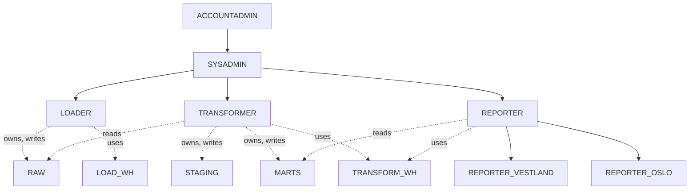

# Security and access control

The Snowflake side is set up as code in `snowflake/`. Role-based access control (RBAC) with
three functional roles separates the layers, one service user runs the pipeline with a key
pair, and row access policies limit regional roles to their region.

## Roles



| Role | May do | May not do |
|---|---|---|
| `LOADER` | create stages and file formats, `PUT` files, `COPY INTO` the RAW tables, write the load audit; use `LOAD_WH` | read or write `STAGING` and `MARTS` |
| `TRANSFORMER` | read `RAW`; create and replace everything in `STAGING` and `MARTS`; create and attach row access policies; use `TRANSFORM_WH` | write `RAW` |
| `REPORTER` | read tables and views in `MARTS`, now and in the future; use `TRANSFORM_WH` | see `RAW` or `STAGING` |
| `REPORTER_VESTLAND`, `REPORTER_OSLO` | the same as `REPORTER`, restricted by the row access policies to one region | see other regions |

The custom roles hang under `SYSADMIN`, so an administrator inherits them. Each writing
role owns the schema it writes, which keeps `GRANT` lists short and makes ownership of the
objects dbt recreates predictable.

## Service user and secrets

One service user, `LDL_SVC`, runs the loader (as `LOADER` on `LOAD_WH`) and dbt (as
`TRANSFORMER` on `TRANSFORM_WH`). It is a `SERVICE` user: no password, no interactive
login, key-pair authentication only. The private key lives outside the repository in an
encrypted PKCS#8 file; its path and passphrase, the account and the user name are read from
environment variables (see `.env.example`). The dbt profile in `~/.dbt/profiles.yml` reads
the same variables. Nothing secret is in the project tree, and `.gitignore` excludes the
files that could hold secrets.

`snowflake/make_keypair.py` creates the key pair and prints the public key for
`02_roles_and_users.sql`.

A second service user, `LDL_REPORT_SVC`, exists for Power BI Desktop. The Snowflake
connector there signs in with a password, a Microsoft Entra ID account or a key pair, and
cannot complete a browser single sign-on or an MFA prompt, so the report uses a key pair of
its own. The user holds `REPORTER` and the two regional reporter roles and nothing else: it
reads `MARTS` through the same row access policies as any other reader and cannot see
`RAW` or `STAGING`.

## Row access policies

Two policies in `MARTS` mirror the regional row-level security of the Power BI report:

- `REGION_POLICY (region)` is attached to `dim_customer` and `mart_monthly_category_region`;
- `CUSTOMER_REGION_POLICY (customer_id)` is attached to `fct_transactions` and
  `fct_account_balance_daily` and looks up the customer's current region.

Both allow everything for `ACCOUNTADMIN`, `SYSADMIN`, `TRANSFORMER` and `REPORTER`, and
otherwise return only rows whose region is mapped to `CURRENT_ROLE()` in the table
`MARTS.REGION_ACCESS` (`role_name`, `region`). Adding a regional role is one `INSERT`.

dbt attaches the policies in post-hooks on the Snowflake target after every build, so a
full refresh, which recreates the tables, cannot leave them unprotected. On DuckDB the
hooks render to nothing. Because the second policy refers to `DIM_CUSTOMER`, the policy
script runs once more after the first build of that table; the order is documented in the
script itself.

To check the policy, run the same query under two roles:

```sql
USE ROLE REPORTER;           SELECT region, count(*) FROM MARTS.DIM_CUSTOMER GROUP BY 1;
USE ROLE REPORTER_VESTLAND;  SELECT region, count(*) FROM MARTS.DIM_CUSTOMER GROUP BY 1;
```

## Limits

- The policies key on `CURRENT_ROLE()`, not on the role hierarchy. A user who activates
  `REPORTER` directly sees everything, which is what the unrestricted reporting role is for.
- The policy on the facts uses the customer's current region, like the monthly report.
- `STAGING` carries no policy; it is visible to `TRANSFORMER` only.
- Network policies and single sign-on are not part of this setup.
